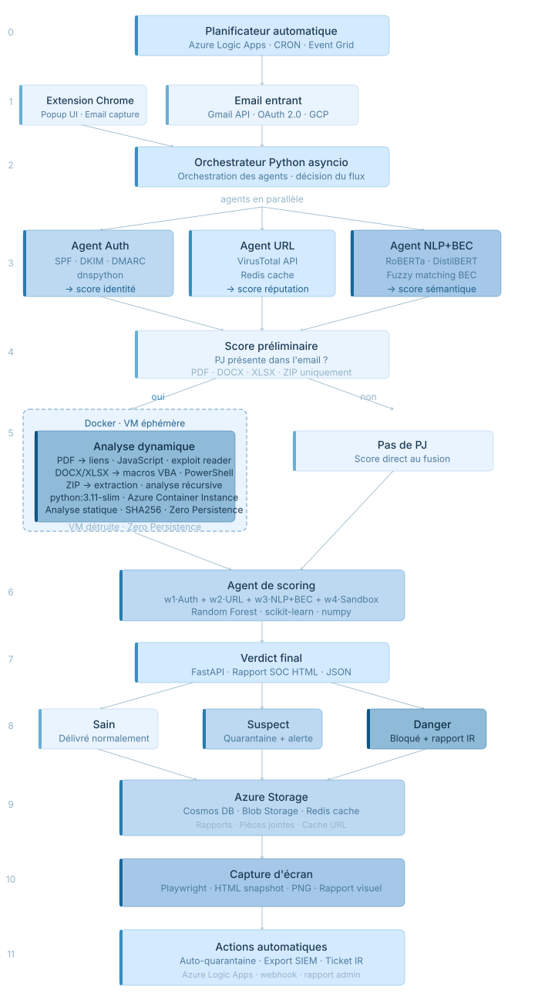

# ThreatIntel: Multi-Agent Email Threat Detection

**Automated detection of phishing and Business Email Compromise (BEC), built as a cloud-native, multi-agent pipeline.**

ThreatIntel analyzes every incoming email through five specialized agents running concurrently, then fuses their findings into a single explainable risk verdict. It combines protocol-level checks (SPF/DKIM/DMARC), URL reputation, transformer-based language analysis, attachment sandboxing and machine-learning scoring.

> End-of-year engineering project (PFA 2), École Nationale d'Ingénieurs de Tunis (ENIT), 2025/2026.



---

## Why this project

Phishing and BEC remain the most costly email-borne attacks. Signature-based filters miss them because BEC emails often contain no malicious link or attachment: the attack is in the language and in the sender's identity. ThreatIntel addresses this by looking at an email from several independent angles and combining the evidence instead of relying on a single detector.

## Key features

- **Five specialized agents** orchestrated asynchronously with Python `asyncio`.
- **Sender authentication analysis**: SPF, DKIM, DMARC, Reply-To mismatch, free-domain executive impersonation (e.g. a "CEO" writing from a free webmail address).
- **URL reputation** through VirusTotal, with a Tranco-based allowlist and override rules for abused legitimate services (tunnels, shorteners).
- **NLP detection of phishing and BEC** using fine-tuned DistilBERT / RoBERTa models, with multilingual (English, French, Arabic) pressure and secrecy patterns.
- **Attachment sandbox** for dynamic analysis of suspicious files.
- **Risk scoring** with Random Forest / XGBoost over the agents' outputs.
- **Resilience**: circuit breaker with a local blacklist fallback when an external API is down.
- **Performance**: SHA-256 deduplication with a Redis cache in front of Cosmos DB.
- **Explainable verdicts** with generated HTML reports.
- **Analyst tooling**: React dashboard and a VS Code extension for triage.
- **Automation**: Gmail polling and an Azure Logic App workflow for ingestion.

## Architecture

```
Incoming email
      |
      v
[SHA-256 hash] --> [Redis cache] --hit--> immediate verdict
      | miss
      v
[Cosmos DB] --hit--> fast verdict + Redis refill
      | miss
      v
+-----------------------  Orchestrator (asyncio)  -----------------------+
|  Auth agent  |  URL agent  |  NLP / BEC agent  |  Sandbox agent        |
+---------------------------------+-------------------------------------+
                                  |
                          Scoring agent (RF / XGBoost)
                                  |
                                  v
                 Verdict + HTML report --> Redis + Cosmos DB
```

| Agent | File | Role |
|---|---|---|
| Authentication | `agents/agent_auth.py` | SPF/DKIM/DMARC, header consistency, executive impersonation |
| URL | `agents/agent_url.py` | VirusTotal reputation, Tranco allowlist, tunnel/shortener overrides |
| NLP / BEC | `agents/agent_nlp_bec.py` | DistilBERT / RoBERTa classification and BEC language patterns |
| Sandbox | `agents/agent_sandbox.py` | Dynamic analysis of attachments |
| Scoring | `agents/agent_scoring.py` | Fusion of all signals into a final risk score |

## Tech stack

| Area | Technologies |
|---|---|
| Backend | Python, FastAPI, asyncio |
| AI / ML | Hugging Face Transformers (DistilBERT, RoBERTa), scikit-learn, XGBoost |
| Cloud | Azure (Cosmos DB, Blob Storage, Functions, Logic Apps), GCP |
| Data | Redis, Azure Cosmos DB |
| Frontend | React, Vite, Tailwind CSS |
| Tooling | Docker / Docker Compose, VS Code extension (TypeScript) |
| Threat intel | VirusTotal API |

## Repository layout

```
agents/                 The five detection agents
orchestrator.py         Async pipeline coordinating the agents
api.py / server.py      FastAPI service
cache.py                Redis + Cosmos DB caching layer
cosmos_client.py        Cosmos DB integration
report_generator.py     HTML verdict reports
dashboard/              React analyst dashboard
src/                    VS Code extension (poller, verdict panel, blacklist)
threatintel-function/   Azure Function
scripts/                Gmail polling and analysis helpers
evaluate_*.py           Evaluation and blind-spot test suites
reports/                Evaluation reports and project chapters
```

## Getting started

### Prerequisites

- Docker and Docker Compose
- An Azure Cosmos DB account (Core SQL API)
- A VirusTotal API key
- Python 3.11+ (for local development)

### 1. Create the Cosmos DB account on Azure

1. Go to https://portal.azure.com and search for **Azure Cosmos DB**, then click **Create**.
2. Choose **Core (SQL)**.
3. Account name: `pfa-email-threats`.
4. Capacity mode: **Serverless** (cheap for testing).
5. Region: `France Central`.
6. After creation, open **Keys** and copy the **URI** and the **Primary key**.

### 2. Configure your environment

```bash
cp .env.template .env
```

Fill in `.env` with your own credentials:

```
COSMOS_ENDPOINT=https://<your-account>.documents.azure.com:443/
COSMOS_KEY=<your-primary-key>
VT_API_KEY=<your-virustotal-key>
```

Also set the Azure, Hugging Face and SMTP values listed in `.env.template`. **Never commit this file**, it is already listed in `.gitignore`.

### Run with Docker

```bash
docker compose up --build
```

Docker builds the Python image, starts Redis and starts the API. It is then available at `http://localhost:8000`, with interactive documentation at `http://localhost:8000/docs`.

```bash
docker compose logs -f orchestrator   # follow the logs
docker compose down                   # stop everything
```

### Run locally

```bash
python -m venv venv
source venv/bin/activate        # Windows: venv\Scripts\Activate.ps1
pip install -r requirements.txt
python main.py
```

### Dashboard

```bash
cd dashboard
npm install
npm run dev
```

## API usage

Analyze an email:

```bash
curl -X POST http://localhost:8000/analyze \
  -H "Content-Type: application/json" \
  -d '{"subject":"Urgent wire transfer","sender":"ceo@example.com","body":"Please process this payment today."}'
```

| Endpoint | Description |
|---|---|
| `POST /analyze` | Analyze one email and return the verdict |
| `GET /history` | Previously analyzed emails |
| `GET /stats` | Aggregate statistics |
| `GET /docs` | Interactive OpenAPI documentation |

## Evaluation

The project ships with dedicated test suites that probe each agent, including known blind spots (executive impersonation from free domains, abused tunnel services, multilingual BEC, obfuscated text). Results are stored in [`reports/`](reports/).

| Script | Purpose |
|---|---|
| `evaluate_agents_confusion.py` | Confusion matrix across agents |
| `evaluate_auth_blindspots.py`, `evaluate_auth_stress.py` | Authentication agent stress tests |
| `evaluate_nlp_blindspots.py`, `evaluate_nlp_ultra_real.py` | NLP agent evaluation on realistic samples |
| `test_red_team.py`, `test_regression.py` | Red-team scenarios and regression checks |

<!-- Add your headline metrics here, for example:
| Metric | Value |
|---|---|
| Precision | xx % |
| Recall | xx % |
| F1-score | xx % |
-->

## Security notes

- All secrets are loaded from environment variables. No credentials are stored in the repository.
- Test emails and attachments in this project are synthetic or sanitized samples for evaluation purposes only.
- Do not run the sandbox agent on a machine that is not isolated.

## Roadmap

- Larger multilingual BEC dataset
- Retraining pipeline with analyst feedback from the dashboard
- Additional threat-intelligence feeds beyond VirusTotal
- Support for more mail providers

## Author

**Amira Ferchichi**, Telecommunications Engineering student, ENIT (Cloud and Cybersecurity track)

- GitHub: [Amira-ferchichi-9](https://github.com/Amira-ferchichi-9)
- LinkedIn: [amira-ferchichi](https://www.linkedin.com/in/amira-ferchichi)

Supervisor: _to be completed_

## License

Released under the MIT License. See `LICENSE`.
